# Diagrama de Clases UML - Archivo Central y Títulos y Grados (UAGRM)

A continuación se presenta el **Diagrama de Clases UML completo** en código **Mermaid.js**, estructurado en 3 capas:
1. **Modelos de Negocio y Base de Datos (ORM Django / PostgreSQL)**
2. **Capas de Servicios y Almacenamiento (API REST / MinIO)**
3. **Módulos y Componentes Frontend (React / TypeScript)**

---

## 📊 Código Mermaid.js (Diagrama de Clases)

```mermaid
classDiagram
    direction TB

    %% ==========================================
    %% ENUMERACIONES (ENUMS)
    %% ==========================================
    class EstadoLibro {
        <<enumeration>>
        ABIERTO
        CERRADO
    }

    class EstadoVerificacion {
        <<enumeration>>
        VERIFICADO
        CONVALIDADO
        PENDIENTE
    }

    class TipoPlantilla {
        <<enumeration>>
        TIPO_1_PROVISION_NACIONAL
        TIPO_2_ACLARATORIA_HISTORICA
        TIPO_3_COPIA_LEGALIZADA_OCR
        TIPO_4_SUPLETORIO_REVALIDA
        TIPO_5_AUTENTICIDAD_QR
    }

    class TipoDocumentoDossier {
        <<enumeration>>
        CERTIFICADO_NACIMIENTO
        NOTAS_SECUNDARIA
        DIPLOMA_BACHILLER
        FORMULARIO_TRAMITE
        FOJA_UNICA_OCR
    }

    %% ==========================================
    %% MODELOS BASE DE DATOS: ARCHIVO CENTRAL (JERARQUÍA FÍSICA)
    %% ==========================================
    class GestionArchivo {
        +int id
        +int gestion_year
        +string descripcion
        +boolean cerrada
        +obtener_tomos() List~TomoLegajo~
    }

    class CarreraArchivo {
        +int id
        +string codigo_carrera
        +string nombre_carrera
        +string facultad
        +obtener_tomos() List~TomoLegajo~
    }

    class TomoLegajo {
        +int id
        +int gestion_id
        +int carrera_id
        +string nro_tomo
        +string nro_titulo_inicial
        +string nro_titulo_final
        +int total_hojas
        +EstadoLibro estado_libro
        +date fecha_clausura
        +obtener_rango_correlativo() string
        +obtener_graduados() List~GraduadoLegajo~
    }

    class GraduadoLegajo {
        +int id
        +int tomo_legajo_id
        +string nro_titulo_correlativo
        +string nombre_completo
        +string ci
        +date fecha_emision
        +EstadoVerificacion estado_verificacion
        +string ci_pdf_url
        +string notas_pdf_url
        +string diploma_pdf_url
        +string foja_unica_ocr_url
        +obtener_dossier_completo() DossierResponse
    }

    %% ==========================================
    %% MODELOS BASE DE DATOS: TÍTULOS Y EXPEDIENTES
    %% ==========================================
    class ExpedienteEstudiante {
        +string expediente_id
        +string ci
        +string nombre_completo
        +string carrera
        +string nro_diploma_original
        +date fecha_creacion
        +obtener_documentos() List~DossierDocumento~
    }

    class DossierDocumento {
        +string documento_id
        +string expediente_id
        +TipoDocumentoDossier tipo_documento
        +string nombre_archivo
        +string minio_object_key
        +boolean ocr_completado
        +datetime fecha_subida
        +obtener_presigned_url() string
    }

    class TituloEmitido {
        +string titulo_id
        +string expediente_id
        +TipoPlantilla tipo_plantilla
        +string nro_certificado
        +string nro_titulo
        +string libro_registro
        +string fojas
        +date fecha_emision
        +string autoridad_secretario
        +string autoridad_rector
        +string hash_qr_sha256
        +generar_pdf() bytes
    }

    class InformeAutenticidad {
        +string informe_nro
        +string expediente_id
        +string nro_testimonio
        +string apoderado
        +string rector_actual
        +date fecha_solicitud
        +validar_autenticidad() boolean
    }

    %% ==========================================
    %% RELACIONES DE MODELOS DE DATOS (ORM)
    %% ==========================================
    GestionArchivo "1" -- "*" TomoLegajo : contiene
    CarreraArchivo "1" -- "*" TomoLegajo : clasifica
    TomoLegajo "1" -- "*" GraduadoLegajo : indexa correlativamente
    ExpedienteEstudiante "1" -- "*" DossierDocumento : posee
    ExpedienteEstudiante "1" -- "*" TituloEmitido : genera
    ExpedienteEstudiante "1" -- "0..1" InformeAutenticidad : respalda
    TomoLegajo ..> EstadoLibro : usa
    GraduadoLegajo ..> EstadoVerificacion : usa
    DossierDocumento ..> TipoDocumentoDossier : usa
    TituloEmitido ..> TipoPlantilla : usa

    %% ==========================================
    %% SERVICIOS Y CONTROLADORES API (BACKEND / FRONTEND API CLIENT)
    %% ==========================================
    class ArchivoCentralApiService {
        +getGestiones() List~GestionArchivo~
        +getCarreras(gestion_id) List~CarreraArchivo~
        +getTomos(gestion_id, carrera_id) List~TomoLegajo~
        +getGraduadosIndexados(tomo_id) List~GraduadoLegajo~
    }

    class TitulosApiService {
        +buscarExpedientes(params) List~ExpedienteEstudiante~
        +getDossier(expediente_id) DossierResponse
        +getPresignedViewUrl(minio_key) string
        +guardarBorradorCertificado(payload) GuardarBorradorResponse
        +getInformeAutenticidadContext(id) InformeAutenticidadContext
    }

    ArchivoCentralApiService ..> TomoLegajo : consulta
    ArchivoCentralApiService ..> GraduadoLegajo : consulta
    TitulosApiService ..> ExpedienteEstudiante : consulta
    TitulosApiService ..> TituloEmitido : gestiona

    %% ==========================================
    %% COMPONENTES FRONTEND (INTERFAZ DE USUARIO)
    %% ==========================================
    class BusquedaExpedientesArchivoPage {
        -selectedGestion: int
        -selectedCarrera: int
        -selectedTomo: int
        +renderFiltrosCascada()
        +renderTablaGraduados()
    }

    class FiltroCascadaJerarquico {
        +gestiones: List
        +carreras: List
        +tomos: List
        +onSelectGestion(id)
        +onSelectCarrera(id)
        +onSelectTomo(id)
    }

    class TablaGraduadosIndexada {
        +graduados: List~GraduadoLegajo~
        +onVerExpediente(graduado_id)
        +onEmitirCertificado(graduado_id)
    }

    class VisorLegajoDrawer {
        +expediente_id: string
        +documentos: List~DossierDocumento~
        +selectedDocumento: DossierDocumento
        +onSelectDocumento(doc)
    }

    class PlantillaCertificacionForm {
        -tipoPlantilla: TipoPlantilla
        -paperSize: string
        -zoomLevel: number
        +handleConsultarAutocompletar(term)
        +handleSaveDocument()
        +handlePrint()
    }

    class CertificadoTituloRenderer {
        +props: TituloEmitido
        +paperSize: string
        +margenIzquierdo: string
        +renderTemplate()
    }

    BusquedaExpedientesArchivoPage *-- FiltroCascadaJerarquico : integra
    BusquedaExpedientesArchivoPage *-- TablaGraduadosIndexada : integra
    BusquedaExpedientesArchivoPage *-- VisorLegajoDrawer : abre
    BusquedaExpedientesArchivoPage ..> ArchivoCentralApiService : usa

    PlantillaCertificacionForm *-- CertificadoTituloRenderer : previsualiza
    PlantillaCertificacionForm ..> TitulosApiService : consume
```



---

## 📖 Instrucciones de Uso y Renderizado de Mermaid.js

Para renderizar visualmente este diagrama de clases en diagramas navegables, gráficos o documentos PDF, puedes utilizar cualquiera de las siguientes 4 opciones simples:

### Opción 1: Mermaid Live Editor (Sitio Web Gratuito)
1. Ingresa a [https://mermaid.live/](https://mermaid.live/)
2. Copia todo el bloque de código encerrado en ` ```mermaid ... ``` ` de arriba.
3. Pégalo en el editor de la izquierda.
4. El diagrama UML de clases se generará automáticamente a la derecha y podrás descargarlo en formato **PNG**, **SVG** o **PDF**.

### Opción 2: VS Code (Plugin de Vista Previa)
1. Instala la extensión **"Markdown Preview Mermaid Support"** en VS Code.
2. Abre cualquier archivo `.md` que contenga el bloque ` ```mermaid `.
3. Presiona `Ctrl + Shift + V` para ver la vista previa gráfica interactiva.

### Opción 3: GitHub / GitLab (Renderizado Nativo)
- Simplemente guarda este archivo con extensión `.md` (ej: `diagrama_clases.md`) y súbelo a GitHub o GitLab.
- Las plataformas renderizarán automáticamente el diagrama de clases interactivo en la pestaña de vista del repositorio.

### Opción 4: Exportación a Draw.io / Notion
- En **Notion**: Crea un bloque de tipo `/code`, selecciona el lenguaje **Mermaid** y pega el código.
- En **Draw.io**: Ve a `Arrange` ➔ `Insert` ➔ `Advanced` ➔ `Mermaid` y pega el código.
