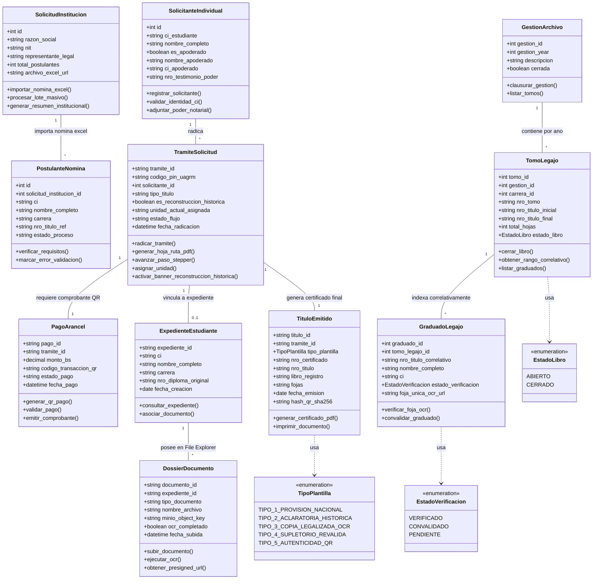

# Mapeo de Pantallas UI React a Diagrama de Clases UML
## Sistema de Títulos, Grados y Archivo Central (UAGRM)

---

## 📌 Paso 1: Mapeo de Pantallas a Clases Entidad (Los Datos)

Cada pantalla, formulario, tarjeta o tabla en React maneja un conjunto de datos que se traduce directamente en una **Clase Entidad**:

| Pantalla / Vista en Frontend (React) | Clase Entidad UML | Atributos Principales |
| :--- | :--- | :--- |
| **Formulario de Registro Individual** (Estudiante / Apoderado) | `SolicitanteIndividual` | `id`, `ci_estudiante`, `nombre_completo`, `es_apoderado`, `nombre_apoderado`, `ci_apoderado`, `nro_testimonio_poder` |
| **Carga Masiva Institucional** (Empresa / Convenios) | `SolicitudInstitucion` | `id`, `razon_social`, `nit`, `representante_legal`, `total_postulantes`, `archivo_excel_url` |
| **Filas de la Tabla de Carga Excel** | `PostulanteNomina` | `id`, `solicitud_institucion_id`, `ci`, `nombre_completo`, `carrera`, `nro_titulo_ref`, `estado_proceso` |
| **Vista del Stepper, Banner Ámbar y Unidad** | `TramiteSolicitud` | `tramite_id`, `codigo_pin_uagrm`, `solicitante_id`, `tipo_titulo`, `es_reconstruccion_historica`, `unidad_actual_asignada`, `estado_flujo`, `fecha_radicacion` |
| **Modal / Widget de Pago por QR** | `PagoArancel` | `pago_id`, `tramite_id`, `monto_bs`, `codigo_transaccion_qr`, `estado_pago`, `fecha_pago` |
| **Visor Global de Dossier del Estudiante** | `ExpedienteEstudiante` | `expediente_id`, `ci`, `nombre_completo`, `carrera`, `nro_diploma_original`, `fecha_creacion` |
| **Documentos dentro del File Explorer Drawer** | `DossierDocumento` | `documento_id`, `expediente_id`, `tipo_documento`, `nombre_archivo`, `minio_object_key`, `ocr_completado` |
| **Gestión Anual en Archivo Central** | `GestionArchivo` | `gestion_id`, `gestion_year`, `descripcion`, `cerrada` |
| **Selector de Tomo/Legajo por Carrera** | `TomoLegajo` | `tomo_id`, `gestion_id`, `carrera_id`, `nro_tomo`, `nro_titulo_inicial`, `nro_titulo_final`, `total_hojas`, `estado_libro` |
| **Tabla Indexada por N° Correlativo** | `GraduadoLegajo` | `graduado_id`, `tomo_legajo_id`, `nro_titulo_correlativo`, `nombre_completo`, `ci`, `estado_verificacion`, `foja_unica_ocr_url` |
| **Previsualizador de Plantillas 1 a 5** | `TituloEmitido` | `titulo_id`, `tramite_id`, `tipo_plantilla`, `nro_certificado`, `nro_titulo`, `libro_registro`, `fojas`, `fecha_emision`, `hash_qr_sha256` |

---

## 🔘 Paso 2: Conversión de Botones y Formularios en Métodos de Clase (`+metodo`)

Las acciones de botones e interacciones del usuario en el Frontend se convierten en **Métodos Públicos (`+`)** de las clases:

| Acción en UI / Botón Frontend | Clase Entidad | Método de Clase UML |
| :--- | :--- | :--- |
| Botón **[ Enviar Solicitud ]** / **[ Radicar Trámite ]** | `TramiteSolicitud` | `+radicar_tramite()` |
| Botón **[ Descargar Hoja de Ruta PDF ]** | `TramiteSolicitud` | `+generar_hoja_ruta_pdf()` |
| Activador del **Stepper / Banner Ámbar** | `TramiteSolicitud` | `+avanzar_paso_stepper()`, `+activar_banner_reconstruccion_historica()` |
| Botón **[ Cargar Nómina Excel ]** de Empresa | `SolicitudInstitucion` | `+importar_nomina_excel()` |
| Validación de pago de **Arancel por QR** | `PagoArancel` | `+validar_pago()`, `+generar_qr_pago()` |
| Botón **[ Ver Foja OCR ]** / **[ Ver Expediente ]** | `GraduadoLegajo` / `DossierDocumento` | `+verificar_foja_ocr()`, `+obtener_presigned_url()` |
| Botón **[ Imprimir Certificado ]** (Plantillas 1 a 5) | `TituloEmitido` | `+generar_certificado_pdf()`, `+imprimir_documento()` |
| Botón **[ Clausurar Libro Matriz ]** | `TomoLegajo` | `+cerrar_libro()`, `+obtener_rango_correlativo()` |

---

## 🔗 Paso 3: Identificación de Relaciones entre Pantallas y Clases

1. **`SolicitudInstitucion` `1` ──── `*` `PostulanteNomina`**
   - *Razón*: Una carga masiva institucional agrupa a múltiples postulantes extraídos de la planilla Excel.
2. **`SolicitanteIndividual` `1` ──── `*` `TramiteSolicitud`**
   - *Razón*: Un estudiante o apoderado puede radicar uno o varios trámites de títulos o supletorios.
3. **`TramiteSolicitud` `1` ──── `1` `PagoArancel`**
   - *Razón*: Todo trámite requiere la validación de un pago de arancel correspondiente.
4. **`TramiteSolicitud` `1` ──── `0..1` `ExpedienteEstudiante`**
   - *Razón*: Al ser verificado en Archivo Central, el trámite se vincula con el expediente histórico del graduado.
5. **`ExpedienteEstudiante` `1` ──── `*` `DossierDocumento`**
   - *Razón*: Un expediente contiene múltiples documentos digitales en su File Explorer (Cédula, Notas, Foja OCR).
6. **`GestionArchivo` `1` ──── `*` `TomoLegajo`**
   - *Razón*: Una gestión anual engloba los libros matrices y legajos empastados de ese año.
7. **`TomoLegajo` `1` ──── `*` `GraduadoLegajo`**
   - *Razón*: Un tomo/legajo agrupa a los graduados ordenados estrictamente por su número de título correlativo.
8. **`TramiteSolicitud` `1` ──── `1` `TituloEmitido`**
   - *Razón*: Un trámite culminado produce la emisión de 1 título/certificado oficial (Plantillas 1 a 5).

---

## 📜 Código Mermaid.js Completo (En Texto Plano)

